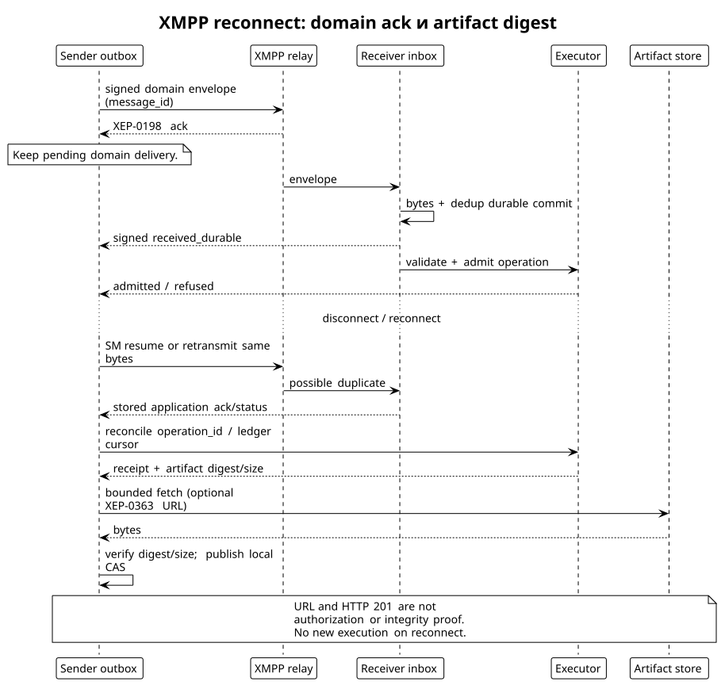
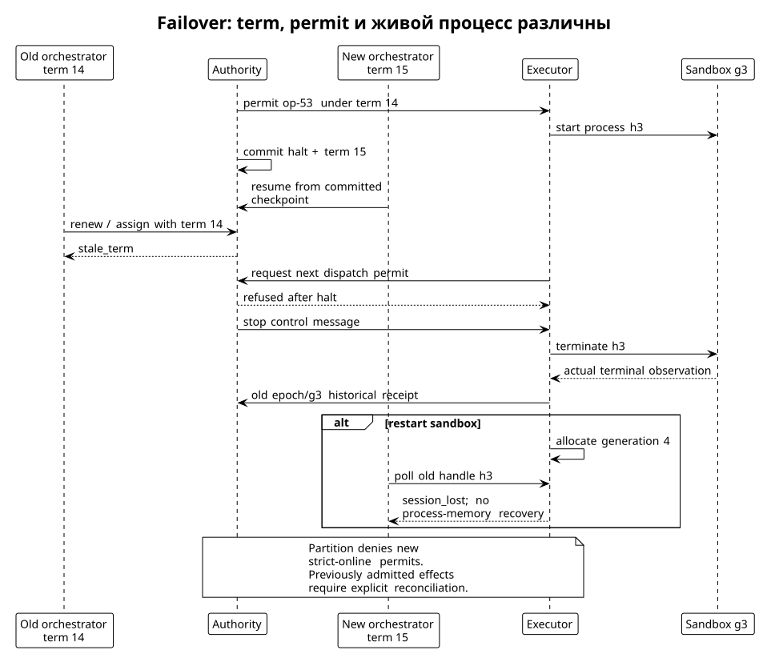

# Authority, идентичности и transport-neutral protocol

Статус: proposed contracts. Следующая normative grammar принадлежит будущему apiary-spec; текущие schemas/v1 не реализуют эти объекты. [Protocol research](../../.research/260908_protocol-literature.md), [каталог первичных источников](../../.research/260908_protocol-source-catalog.json).

## Authority state machine и defaults

L0 — одна логическая authority с одним sequencer и deterministic validator в одном процессе. Journal commit атомарно фиксирует expected revision, новую запись, scope/budget reservation и outbox event. Model worker/orchestrator никогда не пишет ledger напрямую. Durable storage default — transactional local database с WAL, sync и exclusive fenced writer; host/root/storage trusted. Репликация L0 — future crash-tolerant backend, не обещание Byzantine safety.

До обычных worker calls authority совершает bounded `AssignmentCommitted` и `GrantCommitted`. Quorum/authority commit не нужен для каждого байта stdout. При каждом dispatch trusted executor сверяет актуальные stop/contract/epoch/term/generation и атомарно резервирует операцию. В L0 authority и execution admission могут использовать одну transactional command queue, serializing dispatch permit с halt. Remote executor отправляет `DispatchReady`; authority фиксирует `DispatchPermit` с exact operation/body/owner и deadline. Семантика: порядок permit commit определяет момент допуска; halt запрещает permits после своего commit, но не отменяет физически предшествующий permit в пути. Executor дополнительно сверяет локальный stop и deadline непосредственно перед start. Нельзя обещать мгновенный global halt при сетевой partition.

Default `strict-online`: без текущего permit новые effects не стартуют; неизвестная freshness = refusal. Permit действует максимум 5 s и один раз, ограничивая delayed start; это явное окно ранее допущенной работы, не permission cache. Уже начатая sandbox команда ограничена timeout и local stop mechanism. Optional `leased-offline` имеет Δ ≤30 s и clock uncertainty ε ≤1 s, явно ослабляет freshness: новое действие может быть допущено в окне Δ+ε после невидимого revoke, завершение ещё позже на duration D. Это отдельный contract/policy digest; downgrade с strict запрещён. После boot monotonic lease mapping теряется, нужен resync. Неограниченный offline grant отклонён.

Halt stages: `halt_requested → halt_committed → dispatch_disabled → processes_stopped`; `effects_unresolved` может сохраниться. Любая enrolled core-node имеет право единоличного signed `HaltRequest`; authority коммитит stop без model judgement и без ожидания quorum. Worker может отправить bounded stop proposal, но не выдаёт себя за core-node. Resume требует нового committed `ResumeAuthorization` по текущей quorum policy (в L0 одна authority, в L1/L2 соответствующий QC), нового stop generation и reconciliation незавершённых effects; простой heartbeat или новая model session не возобновляет работу. Prompt text не halt authority. Heartbeat/presence — hints, не доказательства смерти. Основания выбора: [halt/lease analysis](../../.research/260908_protocol-literature.md), [Apiary I1/I8](https://github.com/relux-works/apiary-docs/blob/b1ad6d76d803cd3f8e46e2b9621d266d36f3a0c7/paper/paper.tex#L118).

Durable high-water `(project, authority_checkpoint, stop_generation, orchestrator_term)` хранится отдельно от conversation cache и сверяется с committed authority state при boot/restore/renew. Rollback backup ниже high-water отклоняется; неизвестная свежесть блокирует новые effects. При полном разрушении локального high-water требуется authenticated recovery checkpoint от authority/quorum, а не доверие transcript. Revoke/stop после принятого permit не переписывает историю его допуска. Для publication действует специальный [L0 gateway contract](execution.md#l0-publication-gateway-и-recovery-f2): permission commit в authority journal, sole local ref writer, recovery barrier; Git CAS не проверяет Apiary fence сам. Stop запрещает новые permissions; in-flight outcome и drain учитываются отдельно.

## Идентичности не взаимозаменяемы

| Поле | Владелец / scope | Что меняет |
|---|---|---|
| `call_id` | Broker mapping из provider call ID; уникален в epoch | Один model-visible tool вызов, включая отдельный poll |
| `operation_id` | Broker durable allocation; project + grant | Логический execution intent; сохраняется при retries/reconciliation |
| `message_id` | Sender transport outbox | Одно domain delivery сообщение; retry тех же bytes сохраняет ID |
| `process_handle` | Executor, sandbox generation + operation | Живой supervised process group; не PID и не transferable capability |
| `orchestrator_term` | Authority monotonic uint64 | Кто вправе предлагать management mutations; token дополнительно проверяется на равенство |
| `plan_epoch` / `epoch_id` | Runtime immutable SessionPlan | Catalog, grants, model sink, context authority |
| `contract_revision` | Authority TaskContract CAS | Task scope/AC/policy требования; не CR revision |
| `sandbox_generation` | Executor supervisor + authority assignment | Физическая incarnation среды; restart не сохраняет process identity |
| `stop_generation` | Authority monotonic counter | Stop/resume boundary, не orchestration term |
| `writer_generation` | Journal owner | Право append local session/operation records |
| `provider_session_id` | Provider, account/codec scope | Continuation/cache; не grant и не sandbox ID |
| `attempt_id` | Model-host | Одна billable inference attempt; не tool retry |
| `grant_id`, `assignment_id`, `candidate_id` | Authority | Capability allocation, назначение, exact review object |

UUID/opaque identifiers не служат полномочиями сами по себе. Приближение key = `(project, grant, operation)` дополняется authenticated issuer/owner и pinned body digest. Повтор ID с другим body отклоняется даже после cancel/renew/resume. Изменение term не меняет task contract, но stale management writes запрещает; действующие worker grants остаются только если новая authority запись явно сохраняет их.

## Канонические объекты и ownership

| Объект | Issuer | Содержание и смысл |
|---|---|---|
| `TaskContract` | Authority | project/task/revision, base/scope/AC, environment policy, reviewer policy, resource bounds |
| `SessionPlan` | Compiler + policy approval | closure/context/tool schemas, executable/delegable authority, WorkspaceRef/model sink; generic runtime |
| `Assignment` | Authority | contract digest, worker principal, executor/sandbox/generation, plan digest, scope reservation |
| `Grant` | Authority | op allowlist, audience, leases, budgets, term, scope, policy revision, revocation checkpoint |
| `OperationIntent` | Broker/node provenance, executor admits | exact input/call-plan digest, assignment/grant, stable operation ID |
| `ToolReceipt` | Generic broker | plan/call/input/output/provider/observed enforcement; не Apiary authorization |
| `ExecutionReceipt` | Executor | ToolReceipt digest + operation/assignment/contract/sandbox/term, actual outcome/usage/output refs |
| `Submission` | Node signer по host lifecycle | claim о sealed R/C(R), assignment и SnapshotReceipt; не model tool и не execution attestation |
| `Candidate` | Runner/authority | qualified Git locators M/R/I и обязательные SHA-256 content commitments C(M)/C(R)/C(I), полная candidate tuple |
| `ReviewAttestation` | Enrolled reviewer owner | verdict/reason по exact candidate, model/toolchain disclosure с указанной достоверностью |
| `TestAttestation` | Runner | candidate_tuple_digest с C(I), environment/test command/output/exit, measured check coverage |
| `Acceptance` | Authority | deterministic проверка необходимых evidence, candidate tuple и reviewers; не доказательство истины verdict |
| `PublicationIntent` | Authority/gateway | durable exact tuple, permission sequence, term/stop/writer generations, deadline, target reservation до CAS |
| `IntegrationReceipt` | Local publication gateway | publication_id/intent digest, candidate tuple с C(I), durable local ref result; authority сохраняет receipt |

Generic receipt связывается digest, не расширяется полями всех будущих бизнес-доменов. Curator audit endorsement не QC для task. Revision object, tree, Git commit и patch имеют разные identity. Git locator `{object_format,oid}` не сильная identity bytes, даже внутри SHA-256 signed envelope. Обязательная candidate tuple включает strong content manifests C(M)/C(R)/C(I); SHA-256 от recursive path/type/mode/blob/symlink bytes и raw commit metadata определён в [execution: сильная идентичность](execution.md#сильная-идентичность-candidate-bytes-f1). Одного patch-id, root Git object hash или подписи commit недостаточно. Unknown/missing/mismatched content identity запрещает admission evidence.

## Подписи, key lifecycle и replay

Proposed encoding использует существующий Curator canonical JSON profile (CCJ) после отдельного versioned freeze, SHA-256 и Ed25519; не вводим новую криптографию. Для совместимости подписываем только restricted JSON: object keys уникальны, UTF-8, canonical escaping/order, без floats/NaN и неоднозначных чисел; counters unsigned ≤2^53−1 на wire, время integer milliseconds. Отвергаются duplicate keys, invalid UTF-8, depth >16, oversized frames и unknown signed fields. В окончательном freeze exact CCJ revision и vectors обязательны; название CCJ само по себе не interop proof. [Curator registry](https://github.com/relux-works/curator-spec/blob/87a0d0060bad64ab883d007dcdf35df7485368bf/protocol/registry.md#L91).

Signing preimage: ASCII `APIARY\0` + UTF-8 `schema_version` + zero byte + UTF-8 `record_type` + zero byte + canonical unsigned envelope bytes. `signature` исключена, остальные поля, в том числе issuer/audience/key_id/payload/artifact digests, включены. Algorithm фиксируется profile, не выбирается attacker-controlled fallback. Ed25519 public key 32 bytes, signature 64 bytes, base64url без padding; digest `sha256:` +64 lowercase hex. XML не подписывается: framing relay может менять без изменения domain bytes. Пример ниже структурный, signature намеренно отсутствует: его нельзя принять как подписанное сообщение.

```json
{
  "schema_version": "apiary-proposal-1",
  "record_type": "OperationIntent",
  "message_id": "msg-103",
  "issuer": "node-alice",
  "audience": "exec-a",
  "key_id": "alice-node-4",
  "project_id": "prj-apiary",
  "issued_at_ms": 1788825600000,
  "expires_at_ms": 1788825605000,
  "payload": {
    "operation_id": "op-53",
    "call_id": "call-7",
    "assignment_id": "assignment-8",
    "grant_id": "grant-9",
    "contract_revision": 2,
    "orchestrator_term": 14,
    "epoch_id": "epoch-6",
    "plan_digest": "sha256:bbbbbbbbbbbbbbbbbbbbbbbbbbbbbbbbbbbbbbbbbbbbbbbbbbbbbbbbbbbbbbbb",
    "sandbox_id": "sb-17",
    "sandbox_generation": 3,
    "input_digest": "sha256:cccccccccccccccccccccccccccccccccccccccccccccccccccccccccccccccc"
  },
  "artifacts": []
}
```

Signed body несёт digest аргументов, а полный input передаётся inline или content-addressed attachment с тем же digest; до admission bytes должны быть доступны и проверены. Signed digest без доступных bytes не разрешение на произвольный payload. Domain record limit 256 KiB, decoded payload ≤128 KiB, ≤32 artifact refs, каждый ref содержит digest/size/media type и storage identity. Large output/patch идёт через artifact protocol.

Enrollment operator связывает node key с owner и allowed roles. Key certificate содержит issuer, subject, public key, project/audience/roles, validity и serial; certificate chain до pinned project root, revocation checkpoint и monotonic high-water проверяются **до** admission. Unknown/unavailable revocation status при strict policy — отказ. Rotation — committed new key certificate, overlap bounded, old revoked для новых записей; historical signature проверяется с committed signing-time policy, без перезаписи истории. Потеря key требует operator re-enrollment, не recovery из model context.

Node signer имеет лишь `SignSubmission(sealedRevisionRef, assignmentRef)` и `SignReview(reviewRef)` плюс internal enrollment/transport domains. Он читает подтверждённые digests из trusted host state, проверяет project/role/contract/limits и формирует bytes сам. Нельзя подписать supplied arbitrary bytes, новый Grant или project commit. Submission подпись означает «этот участник заявил этот результат». Executor receipt тоже provenance, не доказательство честного executor или правильности кода. Разные keys не доказывают разных людей; membership policy обязана указать external owner evidence и предел Sybil resistance.

Replay scope: durable inbox key `(project, issuer, message_id)` с body digest; execution dedup `(project,grant,operation_id)` отдельно. Exact duplicate возвращает прежний ack/status, changed duplicate — `conflicting_duplicate`. Replay старого epoch сохраняется как historical evidence, но не исполняется. Dedup/tombstones живут как минимум весь grant replay horizon + recovery retention; закрытый grant остаётся неисполняемым после удаления payload. Новый transport ID не обходит operation ledger; новый call ID не возрождает неизвестный intent. Downgrade schema/crypto/assurance/freshness profile запрещён, negotiation выбирает пересечение policy, а не минимальную поддержанную защиту.

## XMPP profile

Baseline transport-neutral API допускает local IPC/HTTPS; требуемый XMPP binding реализует тот же domain state machine. RFC 6120 TLS/SASL/resource binding, ограниченная presence часть RFC 6121; required XEP-0030 discovery и XEP-0198 stream management; namespace proposal `urn:apiary:envelope:1`. DTD/entities запрещены, parser bytes/depth bounds применяются до decoding base64. [RFC 6120](https://www.rfc-editor.org/rfc/rfc6120), [XEP-0198](https://xmpp.org/extensions/xep-0198.html), [XEP-0030](https://xmpp.org/extensions/xep-0030.html).

```xml
<message to="executor@example.org/exec-a" type="normal" id="transport-19">
  <envelope xmlns="urn:apiary:envelope:1" encoding="base64url-ccj">BASE64URL_SIGNED_ENVELOPE</envelope>
</message>
```

Это proposed framing illustration, placeholder не валидный envelope. Full JID routing не authority: domain audience/executor generation проверяются отдельно. Stanza ≤384 KiB с учётом base64 expansion, envelope ≤256 KiB. TLS защищает hops; default XMPP deployment доверяет relay для payload confidentiality и ограничивает data classes. Для недоверенного relay обязательный отдельный reviewed standard encryption profile (например MLS group/application binding) до confidential payload admission; он пока не frozen и потому такой deployment не включён. Подпись payload не шифрование.

| Ack / record | Кто выдаёт | Что гарантирует |
|---|---|---|
| XEP-0198 ack | Stream peer | Ответственность за stanza, не domain execution |
| XEP-0184 receipt (optional) | XMPP client | Delivery hint, не durable business commit |
| `received_durable` | Apiary inbox owner | Envelope bytes и dedup metadata synced; ещё не grant validation |
| `admitted` / `refused` | Executor/authority boundary | Определённый admission outcome и reservation |
| `execution_finished` | Executor | Terminal observation с receipt; возможен `outcome_unknown` |
| `revision_accepted` | Authority | Exact candidate принят по указанной policy |
| `integrated` | Publication gateway/authority | Durable local CAS и receipt exact intent/C(I); не remote mirror success |

Ack vocabulary закрыт; unknown ack нельзя интерпретировать как ближайший success. Application ack сам signed envelope с `in_reply_to` и digest исходного сообщения, чтобы relay не подменил корреляцию. Refusal не стирает `received_durable`. [XEP-0184](https://xmpp.org/extensions/xep-0184.html) не заменяет этот слой.

Sender transaction пишет domain event + outbox; transport удаляет retry item лишь после соответствующего application ack, а не SM ack. Receiver до `received_durable` записывает inbox; processing может позже отвергнуть body. Reconnect сначала XEP-0198 resume, при невозможности новый stream и retransmit unacked outbox; затем reconcile domain ledger cursor и operation status. Не превращать reconnect в новый exec. XEP-0359 IDs диагностические, XEP-0313 archive и XEP-0060 pubsub optional notification surfaces, не authoritative replay/consensus.

Queues bounded: per-peer 256 envelopes/16 MiB, project 4096/128 MiB; oldest non-authoritative telemetry можно coalesce, authority/operation records нельзя silently drop. При fill — `overloaded` до admission, senders backoff с jitter и deadlines; reserved control lane 32 envelopes/1 MiB для halt/cancel/ack, rate-limited по authenticated principal. Disk exhaustion отключает effects. Transport TTL не освобождает execution reservation.

Artifact transfer: signed ref `{digest,size,media_type,store_id}` → authenticated allowlisted fetch → stream into temporary bounded file → verify size/digest → atomic CAS store publication → availability receipt. URL не capability и не доказательство наличия; deny redirects к чужой audience, private network SSRF и decompression bombs. Default max artifact 64 MiB, task total 512 MiB; больше — отдельный grant. XEP-0363 optional upload slot, HTTP 201 только storage readiness; [XEP-0363](https://xmpp.org/extensions/xep-0363.html). Reconnect повторяет chunks по offset/digest, terminal artifact verified до использования. Missing artifact и read failure различаются, оба блокируют acceptance до восстановления.



## Failover и distributed profiles

Orchestrator term выдаёт authority CAS; новый holder получает monotonically increased term + случайный token. Старый orchestrator не может renew, assign, submit management transition или cancel чужой новый run с прежним term. Resume сохраняет observed checkpoint; stale writer fenced на каждом новом admission boundary; ранее committed in-flight permission сохраняет описанную семантику, не превращается в новую current permission. Project scope reservation держится до integration/cancel, execution slot освобождается отдельно. Transfer executor требует committed ownership transfer и доказанного fencing прежнего owner; если sink не умеет fence и эффект неизвестен, transfer этой операции запрещён.

L1 — trusted sequencer + threshold validation signatures; не fork-safe Byzantine consensus. L2 — отдельный проверенный BFT substrate, membership/locking/light-client rules, при обычной модели n≥3f+1 и commit >2/3 voting power. Выбор реализации после qualification; CometBFT — candidate, не уже установленная зависимость. Raft годится для доверенных crash failures, не заменяет L2. [CometBFT spec pin](https://github.com/cometbft/cometbft/blob/3bd679a20b154bcba63aae7edb13faa673103e38/spec/consensus/consensus.md#L1), [Raft](https://raft.github.io/raft.pdf). Consensus упорядочивает deterministic records, не голосует об истинности model reasoning.


