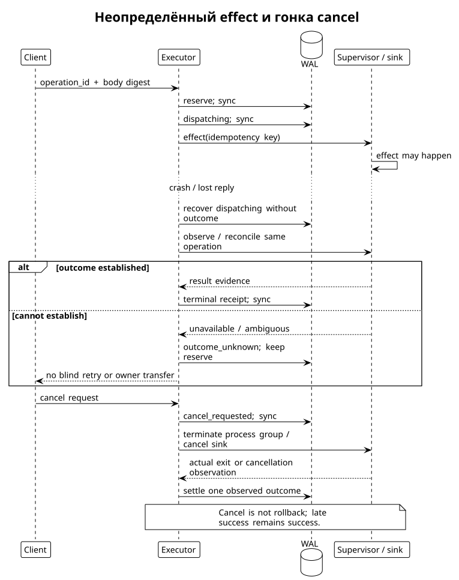
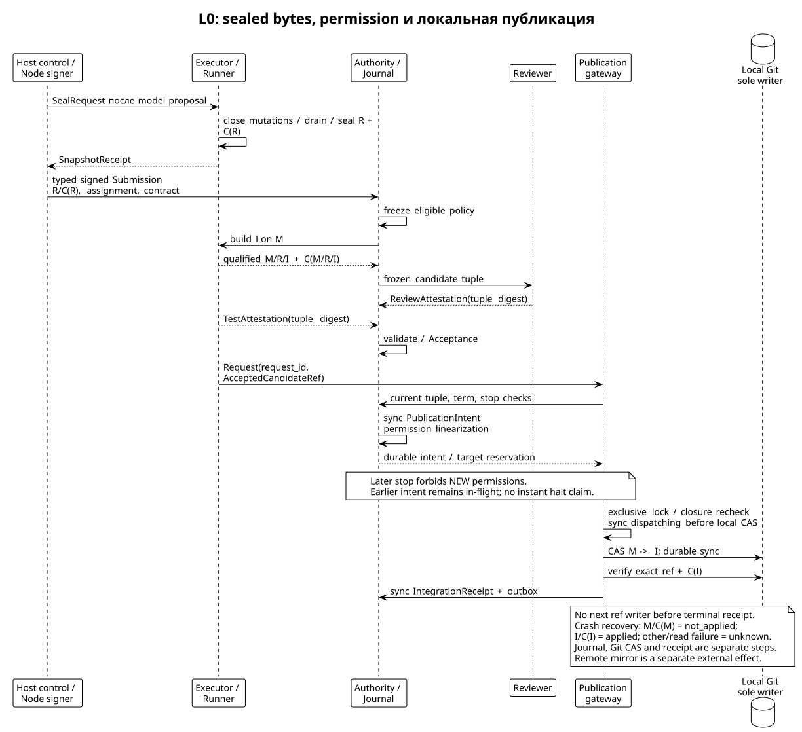

# Исполнение, восстановление и точная интеграция

Статус: proposed contracts. [Wire и authority](authority-wire.md), [central interface](tool-skills.md).

## Admission и WAL исполнителя

Executor — authoritative owner физического sandbox и operation WAL. Broker держит correlation, но локальная память worker не решает, произошёл ли effect. Key операции `(project,grant,operation_id)` резервируется вместе с body digest, authority permit, assignment, sandbox generation, budget и owner **до dispatch** в одной durable transaction. Только после commit возвращается `admitted`. При одинаковом duplicate возвращается stored state; при другом body — conflict. Downstream idempotency key сохраняется при reconnection, renewal и ownership transfer.

Lifecycle закрыт: `reserved → dispatching → running → succeeded | failed | cancelled | outcome_unknown`; `refused` возможен до reservation. `cancel_requested` — отдельный durable flag, не terminal state. `dispatching` записывается до передачи в process supervisor/sink. Recovery видит `reserved` без dispatch marker — может продолжить только после fresh authority check. Recovery видит dispatch marker без доказанного outcome — сначала observe/reconcile, не execute again. Terminal outcome immutable; поздний reconciliation уточняет unknown отдельной causally-linked записью, не переписывает прошлое.

| Сбой | Источник истины | Разрешённое действие |
|---|---|---|
| До durable reserve | Authoritative lookup, не клиентский timeout | Повтор exact intent; если read unavailable — ждать, не считать отсутствующим |
| После reserve, до dispatch marker | WAL owner | Fresh permit и продолжение той же операции |
| После marker, до/после реального effect, до receipt | Supervisor/sink query | `outcome_unknown`; no blind retry, budget retained |
| Receipt synced, reply потерян | Executor WAL | Повторная выдача того же receipt |
| Worker умер, executor жив | Executor и assignment authority | Новый worker получает observations; не сбрасывает budget/operation ID |
| Executor недоступен, lease истёк | Authority + sink fencing proof | Нет доказанного rollback; неизвестную mutation нельзя перенести и повторить |
| Corrupt WAL middle | Storage verifier | Quarantine, stop dispatch; не «пустая база» |

`failed` означает наблюдаемый неуспешный exit/result, но не отсутствие частичных effects. `cancelled` означает подтверждённую остановку процесса, не rollback. `succeeded` означает success конкретной команды, не корректность кода/задачи. Receipt имеет отдельные `exit_code`, `effect_state` (`none`, `partial`, `applied`, `unknown`) и termination observation. Для произвольного shell точный перечень effects может быть unknown; нельзя заменить observation выдуманной полнотой.

Для внешних non-idempotent действий worker grant по умолчанию network-none, без credentials и publication. Именованный runner operation может иметь sink-specific idempotency/fencing contract. Если такого механизма нет, crash after dispatch требует reconciliation или human-owned resolution, не retry с новым operation ID. Даже idempotent endpoint требует достаточного срока dedup retention. Сериализующий gateway без поддержки downstream не устраняет crash gap между external effect и собственной записью.



## Команды, cwd/env и long-running processes

`exec.argv` запускается без implicit login shell. Для shell пользовательская команда должна явно включить `/bin/sh`, `-c`, текст. Нет `source ~/.zshrc`, user HOME, inherited PATH или глобального `chdir`. `cwd` — относительный mount alias path внутри generation. `env` — per-call overlay разрешённых имён поверх pinned base environment; PATH/toolchain/home/tmp задаёт sandbox image. Env names для dynamic loader, credentials, agent sockets и control endpoints не допускаются worker policy. Shell `cd`, `export`, aliases и функции живут только в данном process; следующая команда снова получает explicit cwd/env.

Filesystem сохраняется между командами данной generation, shell memory — нет. Один multi-step script может связать `cd`, build и test внутри одного exec. Модель не должна ожидать persistence произвольного интерактивного shell. Это осознанное уточнение local-like shell из [Apiary paper](https://github.com/relux-works/apiary-docs/blob/b1ad6d76d803cd3f8e46e2b9621d266d36f3a0c7/paper/paper.tex); процессная сохранность требует механизма, а не метафоры.

Supervisor возвращает opaque process handle, связанный с authenticated principal, assignment, operation и sandbox generation. PID остаётся private implementation detail; после restart reuse PID не даёт старому handle полномочий. Baseline stdin закрыт; interactive PTY и произвольный stdin write отложены. Допустим long-running build/server в пределах явно заданного grant/deadline; пока он жив, workspace-exclusive slot занят. Если нужен server и tests одновременно, отдельный scoped read/test concurrency profile должен быть разрешён заранее, не вытекать из shell background `&`.

`poll` — новый model call ID и read-only query к прежнему process/operation; cursor monotonically increasing byte offset + stream ID. Output chunks ≤64 KiB, model view ≤32 KiB/call, stdout/stderr различаются; spool quota 16 MiB/process, overflow останавливает producer согласно pinned policy и сохраняет truncation/digest. Потерянный cursor возвращает `cursor_expired` + available range/artifact ref, не молча начинает с нуля. `cancel` требует владельца handle, записывает request, сигнализирует process group (TERM, затем KILL после 2 s) и ждёт supervisor observation; children должны оставаться в sandbox cgroup/job. Если platform не подтверждает containment descendants, assurance partial.

Cancel racing exit: один supervisor serializes exit и cancel request; terminal exit не заменяется cancellation success. Restart sandbox увеличивает generation: все handles `session_lost`, process state не восстановлен. Files могут быть восстановлены из snapshot как **новая** generation; old receipts остаются historical. Нельзя обещать миграцию памяти процесса, открытых файлов, TCP streams и shell jobs без checkpoint/restore backend — такого backend в baseline нет.

Дополнительные process errors закрыты: `process_not_found`, `process_forbidden`, `cursor_expired`, `output_limit`, `timeout`, `session_lost`, `executor_unavailable`. Они дополняют admission errors; transport availability не определяет effect outcome.

## Sandbox и platform assurance

Executor создаёт disposable per-assignment workspace с pinned base commit/image; main refs и project secrets не mounted. Linux baseline: отдельные user/mount/PID/network namespaces, no-new-privileges, seccomp policy, cgroups CPU/RAM/PIDs, read-only toolchain, writable task root/tmp, denied egress, no host sockets/device nodes. Конкретный backend должен доказать это production probes, а не заявить по наличию container. Недоверенный code может exploit kernel; для hostile multi-tenant code профиль требует VM/microVM boundary и отдельную qualification. Root на host остаётся TCB.

Snapshot/candidate builder использует immutable commit tree, проверяет scope по фактическим diff paths и запрещает protected path edits. Lexical scope intent не достаточен против symlink/hardlink/mount tricks: supervisor ограничивает actual FS. Shell может прочитать весь granted repo, это допустимый containing set, не точный effect trace. Перед выдачей remote task policy определяет data classes, которые contributor/model sink увидят через stdout. Network-none у sandbox не означает, что repo data не уйдёт в model provider: этот sink отдельно admitted.

macOS/iOS: именованные runner jobs (`xcodebuild-test`, `codesign-candidate`, `device-test`) на закреплённой macOS host/toolchain/device identity; модель не получает keychain или unlimited host shell. Physical device state/permissions/session preservation — часть job contract; destructive reset только explicit authorized operation. Apple toolchain, signing service, simulator/device и их операторы — дополнительные TCB и partial isolation classes, не Linux VM по аналогии. Android device job аналогично не uninstall/clear/force-stop ради baseline. Task requiring full isolation для unavailable device capability получает отказ, не fallback.

Каждый environment receipt перечисляет capability classes: filesystem, processes/signals, egress, CPU/RAM/PIDs/disk, devices, credentials, protected publication. Для каждого `full/partial/none`, backend/revision, доказательство и ограничение. Package build assurance Curator и runtime execution assurance не одно поле. [curator-spec assurance](https://github.com/relux-works/curator-spec/blob/87a0d0060bad64ab883d007dcdf35df7485368bf/protocol/assurance.md#L19).

## От задачи до main

Task lifecycle: `proposed → contracted → assigned → executing → submitted → candidate_frozen → reviewing → accepted → integrated`; альтернативы `rejected`, `cancelled`, `blocked`. Названия — proposal state vocabulary, не текущие task-board statuses. Scope reservation живёт до integrated/cancelled, execution slot можно освободить после snapshot. Изменение contract после submission создаёт revision и инвалидирует прежнюю acceptance.

1. Authority фиксирует TaskContract с scope/AC/budget/environment/reviewer policy и revision. Worker получает assigned sandbox от executor, не writable main.
2. Host lifecycle после terminal proposal закрывает admission mutations и поручает executor seal R; точный поток описан ниже. SnapshotReceipt и Submission связывают Git locator R и strong identity C(R); summary не источник tree.
3. Authority фиксирует eligible reviewer set и policy **до** построения I. Runner строит конкретный integration commit I на target M, сохраняет immutable candidate closure C(I), qualified Git locators и recipe. Для L0 I — новый подписанный single-parent commit на M с применённым изменением R; merge commits и переписывание I после review не допускаются. После I commit выбирается randomness/детерминированная selection по уже frozen eligible set. В L0 seed выдаёт доверенная authority после I; это не publicly unbiased randomness. Для adversarial profile нужен проверенный внешний beacon/commit-reveal contract.
4. Независимый `check-initiator` из frozen eligible policy запрашивает test run; его identity отдельно от producer и reviewer, а runner — execution service. Третья роль сама по себе не доказывает независимую машину: environment verifier отдельно устанавливает host/toolchain identity и требуемые independence predicates. При отсутствии требуемого участника задача ждёт/отказывается по policy, self-review fallback запрещён. Review/test environment получает exact I read-only или отдельную disposable copy. Reviewer не может менять I во время оценки. Tests тоже не превращают свою mutable worktree в candidate: исходный I сохраняется, изменения тестовой среды изолированы.
5. Required verdicts/attestations привязываются к tuple `(project,task,contract_digest,policy_digest,assignment_id,plan_digest,sandbox_generation,M,C(M),R,C(R),I,C(I),environment_digest,test_recipe_digest)`. Reviewer independence проверяется по owner enrollment, role separation и policy; declared model family может быть self-report, это явно отмечается.
6. Authority acceptance validator проверяет complete required evidence set, issuer roles, freshness, signatures, exact tuple и refusal outcomes. Arbitrary judgement остаётся в ReviewAttestation. Missing/unreadable/unknown evidence не success. Conformance coverage reports numerator/denominator требуемых checks; это не code coverage.
7. Runner передаёт принятую exact tuple локальному publication gateway. Только gateway владеет authoritative main ref. Он проверяет acceptance, strong closure и M; в authority journal фиксирует PublicationIntent, затем отдельно выполняет Git CAS M→I и отдельно фиксирует IntegrationReceipt. Механизм и crash windows определены ниже; это три durable шага, не cross-store transaction.
8. Изменившийся M требует нового I′/C(I′), review и tests. Успешная публикация означает локальный authoritative ref; remote mirror — отдельный внешний effect, не условно атомарная часть этой операции.



Proposed evidence fragment (не криптографически валидный fixture):

```json
{
  "record_type": "TestAttestation",
  "candidate_id": "candidate-12",
  "contract_revision": 2,
  "base_commit": {"object_format": "sha1", "oid": "1111111111111111111111111111111111111111"},
  "base_content_digest": "sha256:aaaaaaaaaaaaaaaaaaaaaaaaaaaaaaaaaaaaaaaaaaaaaaaaaaaaaaaaaaaaaaaa",
  "integration_commit": {"object_format": "sha1", "oid": "2222222222222222222222222222222222222222"},
  "candidate_content_digest": "sha256:bbbbbbbbbbbbbbbbbbbbbbbbbbbbbbbbbbbbbbbbbbbbbbbbbbbbbbbbbbbbbbbb",
  "candidate_tuple_digest": "sha256:cccccccccccccccccccccccccccccccccccccccccccccccccccccccccccccccc",
  "environment_digest": "sha256:dddddddddddddddddddddddddddddddddddddddddddddddddddddddddddddddd",
  "test_recipe_digest": "sha256:eeeeeeeeeeeeeeeeeeeeeeeeeeeeeeeeeeeeeeeeeeeeeeeeeeeeeeeeeeeeeeee",
  "checks": {"required": 7, "observed": 7, "passed": 7, "unknown": 0},
  "outcome": "passed"
}
```

Числа 7/7 — пример формата, не выполненные здесь tests. Поле candidate_tuple_digest связывает всю обязательную tuple из шага 5, включая C(R); fragment не заменяет полный record. Production acceptance содержит идентичности семи checks и их output refs; одних counters недостаточно. Test code, который проверялся helper-only, не доказывает production gate. Project signing key держит runner signer, подписывающий только разрешённые builder policy exact commit objects с configured human/project identity, не worker. Подпись I создаётся до freeze/review, это build authorization, не Acceptance; добавление/замена подписи после review изменяет raw commit bytes/C(I) и требует нового candidate.

## Сильная идентичность candidate bytes (F1)

Выбран baseline `apiary-content-manifest-1`: legacy SHA-1 Git поддерживается как locator, а **не** как криптографическое commitment содержимого. `GitLocator={object_format,oid}` принимает только `sha1`/40 lowercase hex или `sha256`/64 lowercase hex; actual repository format обязан совпасть. Одинаковый locator никогда не освобождает от проверки C(X). C(X) для M, R и I — `sha256:` от ASCII `APIARY-CONTENT-MANIFEST-1\0` и canonical CCJ manifest bytes. SHA-256 Git также проходит этот manifest contract: два разных пути проверки не вводятся. Это предложенная новая норма apiary-spec; до development нужны frozen CCJ revision/schema и vectors, а не только этот текст.

Manifest — закрытый объект с полями `format`, `commit_bytes` (`sha256`, `size_bytes`), `entries`. `format` ровно `apiary-content-manifest-1`. `commit_bytes` указывает SHA-256 **полных uncompressed raw Git commit bytes**, включая tree/parent headers, author/committer identities и timestamps, encoding, signature headers и message; bytes сохраняются в strong CAS store. Так relevant metadata не выбирается эвристикой. Git locator хранится в Candidate отдельно. Хеш root Git object или строки OID не заменяет entries. Parent headers являются locators истории, не заявлением сильной identity всей предшествующей истории; immediate base M имеет собственный C(M). L0 builder проверяет у I ровно одного parent M, корректную подпись и tree соответствие entries. Protected history ancestry отдельно проверяется Git validator; SHA-256 commitment всей истории здесь не обещается.

`entries` перечисляет **всё рекурсивное дерево**, включая directories (кроме implicit root), а не только diff. Entry имеет ровно `path_b64`, `kind`, `mode`, `size_bytes`, `content_sha256`. Paths — raw Git pathname bytes, canonical unpadded base64url; сортировка по unsigned decoded bytes, никаких Unicode normalization или locale comparisons. Path не пустой, без NUL, ведущего/замыкающего `/`, пустых, `.` или `..` components; reserved `.git` component (включая platform aliases) запрещён; duplicate/prefix-file conflicts отказаны. Directory parent каждого non-root entry обязан присутствовать. `kind/mode` пары закрыты: `directory/040000`, `file/100644`, `file/100755`, `symlink/120000`. Для directory `size_bytes=0`, `content_sha256=null`; для file — точные bytes blob и их SHA-256, для symlink — raw target bytes без разыменования и их SHA-256. Mode строковый и не выводится из umask. Sizes — nonnegative integers ≤2^53−1, digest fields — `sha256:` +64 lowercase hex. Unknown fields/kinds/modes и incomplete traversal отказаны; отсутствие файла не равно failed read.

Default bounds: manifest ≤16 MiB, ≤100000 entries, path ≤4096 bytes, depth ≤128, отдельный blob ≤64 MiB, closure ≤512 MiB; расширение только новой contract policy. Перед hashing проверяются bounds; manifest передаётся как artifact, не inline envelope. Submodule `160000` отказан как `content_unclosed`; `.gitmodules` также запрещён в baseline. LFS pointer в строгом стандартном pointer формате отказан как `content_unclosed`; LFS filters/smudge и все checkout filters, hooks, external attributes/config выключены. Нет сетевого fetching во время materialization. Иная pointer-like строка остаётся обычным файлом и никогда не подменяется внешним содержимым. Будущий LFS/submodule profile обязан закрыть реальные expanded bytes и включить их identity в manifest до admission. Sockets/devices/FIFOs, paths, не представимые без case/normalization collision на целевой FS, и escaping symlink targets получают `content_unsupported`; symlink bytes хешируются отдельно от проверки безопасности их использования.

Executor snapshot builder после writer barrier строит C(R) из sealed snapshot, проверяет scope, сохраняет manifest/commit/blobs по strong digest и подписывает SnapshotReceipt. Runner независимо читает bytes, пересчитывает C(R), строит M/I closure и подписанный I, затем authority фиксирует Candidate tuple. Независимый materializer строит review/test workspace **из SHA-256 store**, не доверяя повторному Git checkout по OID. Он проверяет каждый byte digest, path/type/mode, raw commit metadata и итоговый C(I) до tests; runner receipt связывает input C(I), environment и recipe. Build outputs лежат в отдельной mutable среде; изменение input tree после проверки останавливает run. Read-only input/snapshot обязателен, иначе TOCTOU делает assurance недостаточной.

Gateway перед intent проверяет C(M) actual target и всю candidate closure C(I), соответствие Git objects этим bytes и immutable store retention. До CAS повторно проверяет materialized candidate/target через тот же verifier; immutable local object store закрыт для runner/worker и GC pending candidates. После CAS он сверяет опубликованную closure с C(I) **перед** receipt. Если Git storage не способен одновременно представить разные bytes с одним OID, второй conflicting object отвергается как `content_mismatch`; не подменяется выбранным первым объектом. Storage/root compromise остаётся вне L0 claim. Предположение о collision resistance относится к SHA-256, а не к locator.

SnapshotReceipt, Submission, Candidate, ReviewAttestation, TestAttestation, Acceptance, PublicationIntent и IntegrationReceipt обязаны связывать соответствующий C(R) или полный candidate_tuple_digest; availability refs не заменяют identity. Missing commitment, неподдерживаемый Git format, mismatch и unclosed closure — разные закрытые отказы: `content_identity_missing`, `git_format_unsupported`, `content_mismatch`, `content_unclosed`, `content_unsupported`, `content_limit`, `content_unavailable`. Ни один не разрешает fallback на OID. Named future probe **GIT-IDENTITY / wrong-content-same-locator**: при неизменных M/R/I locators подменить blob bytes, mode, pathname, symlink target или commit metadata по одному; materialize/test/accept/publish обязаны отказать. Это не заявление генерации SHA-1 collision или выполненного runtime test.

## L0 publication gateway и recovery (F2)

Default authoritative target — локальный bare Git repo проекта за **единственным fenced publication gateway**. Это узкий модуль authority host, отдельная OS capability для protected ref storage, а не новый публичный model tool или универсальный сервис. Runner строит/tests/signs candidate, но не имеет write permission к main или object storage gateway. Gateway importer принимает только проверенную strong closure и не запускает hooks. Обычные Git receive-pack/SSH/local writes к protected repo выключены; administrative update идёт через тот же intent protocol. Project root/storage administrator остаётся TCB и может нарушить эти допущения.

L0 fencing конкретен: один kernel-held exclusive process lock на publication domain, без TTL takeover, и единственный локальный writer к ref. Ref transaction исполняется синхронно внутри gateway через qualified library: detached Git subprocess с пережившим owner write credential запрещён; lock не освобождается при живом writer. Library/ref-lock/fsync path входит в TCB и platform qualification; crash successor получает lock только после смерти прежнего процесса. Authority DB хранит gateway writer_generation. Старые runner requests не несут автономного publish capability: gateway проверяет current term/contract/stop в sequencer. Зависший процесс нельзя заменить по heartbeat timeout, пока OS/host fencing не доказан. Два хоста с shared repo/NFS или общий Git hosting endpoint не соответствуют L0. Restart сначала recovery barrier, только затем intake. Следующий ref update запрещён до durable terminal receipt текущего intent; запрещены rewind/delete/force-update. CAS всегда M≠I и fast-forward single-parent I. Candidate objects/strong closure и intent/receipt сохраняются минимум до durable audit checkpoint; pending records никогда не GC.

**Точка линеаризации разрешения** — sync commit `PublicationIntent(state=permitted)` в той же authority DB transaction/sequencer, что сериализует contract/policy/term/stop transitions. Transaction проверяет current Acceptance и полную tuple, expected main M, stop_generation, orchestrator_term, gateway writer_generation, authority checkpoint, principal, candidate availability и отсутствующий pending publication; резервирует target. Intent содержит также стабильный `publication_id`, `candidate_tuple_digest`, qualified M/I, C(M)/C(I), acceptance digest, permission sequence, `dispatch_before_ms` и requested actor. Publication ID не model call ID и не transport ID. Host Request содержит durable request_id, заранее записанный runner вместе с accepted candidate ref; gateway связывает его с publication_id до ответа в intent transaction. Exact duplicate возвращает тот же record, changed duplicate — conflict. Lookup по request_id после timeout не создаёт новую публикацию.

Contract/stop/term commit **перед** intent делает старый request недопустимым (`stale_contract`, `policy_denied`, `stale_term`, `publication_stopped`). Commit **после** intent запрещает новые permissions, но не отзывает ретроактивно уже допущенный effect. Это сознательная in-flight семантика: ранее разрешённая интеграция может стать видна после halt/нового contract. Receipt хранит permission sequence и historical tuple; она не изображает удовлетворение нового contract. Новая contract revision не становится integrated старым receipt. Trusted UI различает `halt_committed` и отдельное observation `publication_drained=true`; обещание «никакой поздней записи после stop» возможно только после завершения drain. Модель или stale runner сами permission не mint.

Gateway начинает dispatch не позже 5 s после permit по trusted local clock. Под lock проверяет deadline и closure, durable пишет `dispatching`, затем вызывает только local Git CAS с expected M. DB transaction уже закончена; Git ref update — отдельная atomic ref operation, sync/durability поведение Git/filesystem входит в qualification. Никакой отдельный delayed publisher не получает ticket для позднего исполнения. Приостановка gateway/OS после dispatch marker может задержать in-flight CAS; 5 s ограничивает **допуск dispatch**, не wall-clock момент завершения эффекта. Contract/stop после marker не магически отменяет syscall. После success gateway проверяет ref и C(I), затем отдельной DB transaction sync сохраняет IntegrationReceipt и terminal outbox. Только после этого снимает pending barrier.

Publication lifecycle закрыт: `permitted → dispatching → applied | not_applied | outcome_unknown`; `permitted → expired | refused` до dispatch. `outcome_unknown` уточняется append-only reconciliation record; он не освобождает barrier. Ошибки слоя дополнительно закрыты: `publication_busy`, `publication_stopped`, `publication_expired`, `publication_conflict`, `publication_store_unavailable`, `publication_recovery_required`, `publication_fence_unproven`. Raw Git exit code — observation, не domain success. Ни generic executor WAL, ни project-board projection не владеют publication intent: owner — authority journal + gateway.

| Crash window | Владелец / authoritative evidence | Recovery и разрешённый retry |
|---|---|---|
| До intent commit | Authority transactional journal под recovery lock | Успешное чтение доказывает отсутствие; fresh admission допускается. Read failure не отсутствие |
| После permitted, до dispatching | Gateway + durable intent; ref обязан быть M/C(M) | Ничего не посылалось; successor фиксирует not_applied, требует новый fresh permit. Не наследует старую permission; истёкший deadline → expired |
| После dispatching, CAS ещё не вызван либо ответ потерян | Sole-writer repo под exclusive barrier, один pending intent | Читать exact ref и closure. M/C(M) → not_applied; I/C(I) → applied. Повтор CAS по marker запрещён; новое намерение только после terminal и fresh admission |
| CAS applied, до receipt commit | Тот же локальный ref I + C(I), pending intent, M≠I, no-rewind/no-next-writer | Связь с intent следует из единственного writer/pending update; sync восстановленных Git refs/objects до append receipt. Ни ancestor alone, ни внешний reflog не нужны |
| Receipt synced, reply потерян | Immutable journal receipt/outbox | Вернуть тот же receipt; никакого нового Git update |
| Любой unknown read, другой ref, повреждённая closure, нарушенный lock/durability invariant | Evidence недостаточно | outcome_unknown, publication barrier остаётся; repair/re-enrollment operator, без guessing по ancestry или возврата к M |

При crash durability допускает восстановленный ref M либо I, но никогда torn arbitrary ref; если backend этого не доказывает, qualification отказывает. Если наблюдался applied до crash, а receipt ещё не synced, gate никому не выдавал durable integration success. Success receipt пишется только после durable Git sync; потеря уже подтверждённого durable storage — corruption/disaster recovery, не обычный retry. Эти предпосылки позволяют установить исход **локальной** операции без распределённой транзакции и без обещания для произвольного внешнего sink.

Remote mirror/export — отдельная named runner operation со своим operation_id/WAL, exact local IntegrationReceipt/C(I), endpoint credentials и explicit sink policy. Внешний Git CAS обычно не знает Apiary term/stop. Timeout после отправки может навсегда оставить `outcome_unknown` без authoritative remote audit/idempotency evidence; текущий ref/ancestor не доказывает связь с конкретным effect. Mirror lag/failure отображается отдельно от локального integrated. Требование сделать сторонний Git host authoritative требует другого qualified gateway/sink contract и миграции authority location; автоматически такой fallback не включается.

## Host-controlled seal и Submission после model stop

Completion proposal не является TaskAccepted и не является новым central op. Broker host lifecycle, созданный при committed Assignment, заранее имеет узкую capability `seal-own-assignment`; model process не видит её IPC. После успешного terminal ответа без pending tool calls host фиксирует proposal в своём WAL с assignment/plan/epoch и отправляет идемпотентный SealRequest по **host control port** executor. Abort/length/error или budget stop не превращается в успешную Submission: host может сохранить diagnostic snapshot, но его тип не claim об исполненной задаче.

Executor сверяет authority assignment/contract/generation, закрывает admission новых mutations для этой assignment и ждёт завершения/подтверждённой остановки всех процессов. Pending unknown effect → отказ seal, recovery channel остаётся. Barrier запрещает поздний exec даже из другой transport session. Snapshot builder копирует стабильное дерево в immutable store, проверяет protected scope и строит R/C(R); SnapshotReceipt содержит seal_id, source generation, assignment, contract/plan digests, C(R), Git locator и result. После seal старый sandbox не продолжает editing: для rework нужны новая assignment/generation и авторизованное materialize из R.

Trusted host SubmissionCoordinator проверяет executor receipt, strong artifact availability и свои локальные binding records. Он передаёт node-signer только `SignSubmission(sealedRevisionRef, assignmentRef)`. Signer самостоятельно получает verified receipt и строит exact Submission envelope (summary digest — недоверенное приложение); подписывает node key только при разрешённой роли/проекте/assignment. Broker durable outbox доставляет envelope в authority `SubmitCandidate` с expected contract revision. Authority проверяет signature/issuer, receipt issuer и tuple, сохраняет received submission или явный refusal. Retry после потери ответа сохраняет submission_id/body; stale contract не переписывает подпись под новую revision. Node signer недоступен модели, generic core не знает команд seal/submit, central остаётся exec/poll/cancel.

Proposed Go ports для host modules (не implementation и не model catalog):

```go
type SnapshotControlPort interface {
    Seal(ctx context.Context, request BoundSealRequest) (SnapshotReceipt, error)
}
type SubmissionSigner interface {
    SignSubmission(ctx context.Context, revision SealedRevisionRef, assignment AssignmentRef) (SignedSubmission, error)
}
type PublicationGateway interface {
    // Validates current authority and commits intent; no arbitrary ref or bytes API.
    Request(ctx context.Context, request BoundPublicationRequest) (PublicationView, error)
    Observe(ctx context.Context, id PublicationID) (PublicationView, error)
}
```

Эти ports принадлежат Apiary host/executor/authority модулям. Generic BrokerPort.Close только закрывает runtime session; он не объявляет задачу принятой. Отказ seal/sign/submit сохраняет proposal и typed failure в host WAL; task не продвигается автоматически. Host crash после seal получает тот же receipt по seal_id; signer/outbox retry не создаёт новый R или новую задачу.

## Coding walkthrough

Задача: исправить parser, который принимает отрицательный timeout, и добавить regression test. Contract r2 разрешает `internal/parser/**`, baseline M, Go toolchain/image digest, network-none, 200 exec requests/30 min allocation; readonly остальной repo, protected config/main/signing недоступны. Нужны test negative timeout, valid zero/positive и review независимого owner. Worker profile — direct admitted ModelPort, remote WorkspaceRef `sb-17/g3`, один central.

Worker получает immutable task/context bundle. `central.exec` с `argv=["rg","timeout","internal/parser"]`, `cwd="repo"`, `env={}` создаёт call-1/op-1; broker связывает grant, executor получает permit, reserve/sync/start/receipt. Модель видит bounded output с source/digest. Следующий exec явно запускает shell script, который применяет ограниченный patch в parser/tests; unknown shell effects ограничены task mount policy. Попытка изменить `.github` denied платформой и snapshot scope check независимо от текста команды.

`central.exec go test ./internal/parser` создаёт call-3/op-3. Если команда дольше 2 s, ответ running+handle h3; call-4 `poll h3` не повторяет op-3. Следующий test run — новый operation, поскольку это новое намерение. Модель сравнивает exit/output и при необходимости исправляет код в прежней generation. Terminal answer содержит brief result и становится только completion proposal. Host control выполняет описанный выше Seal/Submission flow: snapshot C(R), typed node signature, authority SubmitCandidate. Runner строит I/C(I), другой reviewer проверяет exact bytes и negative tests, authority принимает evidence, sole-writer gateway публикует I по durable intent. Worker не имел ни checkout локально, ни git push key, ни authority signing.

## Failure walkthroughs

**Stream truncation.** Модель прислала завершённый JSON `exec`, затем terminal `length`. Broker сохраняет interrupted attempt, не допускает op, effect count zero. Новый inference attempt видит interruption; ID старого partial call не исполнен.

**Потерянный ответ после build.** op-3 succeeded в executor WAL, XMPP response потерян. Worker повторяет observation через новый transport message; exact operation lookup возвращает прежний receipt. Build не запускается повторно. Если WAL read failed — status unknown, не not-found fallback.

**Публикация с неопределённым исходом.** L0 gateway упал после Git CAS до journal receipt. Recovery удерживает exclusive ref-writer barrier, читает единственный pending intent и локальный ref. I с проверенным C(I) означает applied, M с C(M) — not_applied; другой ref/read error означает unknown и закрывает новые публикации. Ни новый term, ни ancestor relation не заменяют эту проверку. Remote mirror timeout остаётся отдельным outcome_unknown и не отменяет уже доказанную локальную интеграцию.

**Failover во время shell.** Authority term 15 заменяет 14, stop запрещает новые permits. Старый orchestrator renewal denied. Уже начатый process h3 останавливается supervisor или достигает timeout; его late receipt остаётся epoch-6/g3 historical. Перенос worker не перемещает h3; sandbox restart создаёт g4 и session_lost. Новая generation не выдаётся за возобновлённую shell memory.

**Target advanced во время review.** Reviewer принял I на M, main уже M′. CAS refusal инвалидирует landing attempt. Runner создаёт I′; даже unchanged patch и непересекающиеся пути требуют нового exact-candidate evidence. Старый verdict доступен как reference, не accepted evidence I′.
