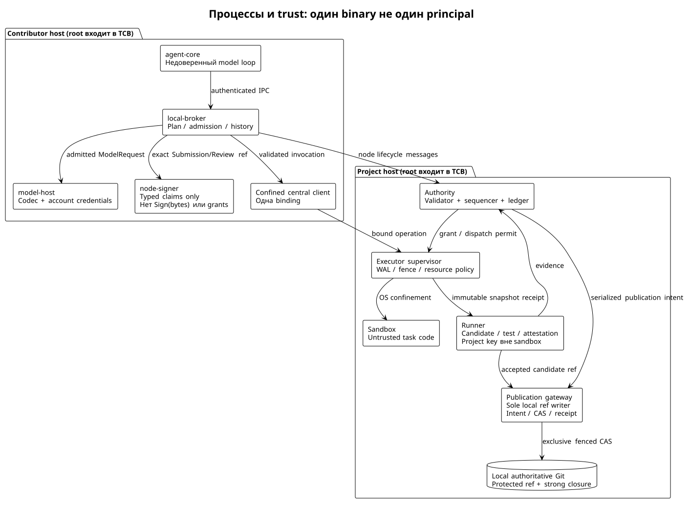
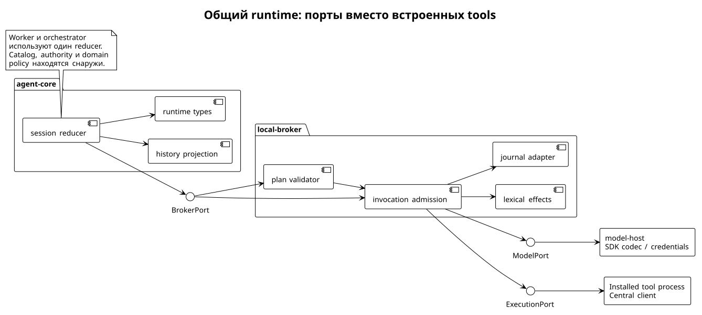

# Общее ядро, профили и доверенные процессы

Статус: proposed architecture, `apiary-design-2026-09-08`. [Карта чтения](../../.spec/apiary-runtime-design.md).

## Разделение ответственности

Модель предлагает действие, validator решает допустимость перехода, sequencer упорядочивает записи, executor допускает и исполняет команду, runner наблюдает проверки; sole-writer publication gateway интегрирует точный кандидат по committed permission. Суждение модели не входит в deterministic validator. Основания: [Apiary I1–I10](https://github.com/relux-works/apiary-docs/blob/b1ad6d76d803cd3f8e46e2b9621d266d36f3a0c7/paper/paper.tex#L118), [runtime §2–3](../../protocol/runtime.md), [принятое исследование контрактов](../../.research/260908_apiary-curator-contracts.md).

| Компонент / владелец состояния | Обязанность | Не получает |
|---|---|---|
| `agent-core`, отдельный процесс участника | Turn reducer, transient conversation projection, вызовы broker, bounded streaming; один writer сессии | Host FS, spawn, raw network, ключи, право принимать задачу |
| `local-broker`, operator-owned процесс | Проверка SessionPlan, dispatch installed exports, context store, session WAL, budget reservation и trusted approval UI | Произвольное выполнение из model output вне bindings |
| `model-host`, отдельный credential domain участника | Provider codecs, разрешённый credential injection, refresh и route policy; private history transport | Project publication key, task authority signing |
| `node-signer`, отдельный key domain участника | Типизированные подписи enrollment, node messages, Submission/Review claims по локальной policy | API `Sign(bytes)`, SSH-agent socket для model/tools, mint grants |
| `authority`, проектный процесс L0 | Deterministic transitions, scope reservations, assignments, term, grants, policy revisions, sequencer и ledger в одном сервисе | Model judgement, выполнение arbitrary code |
| `executor-supervisor`, проектный process/OS identity | Durable operation ownership, budget counters, sandbox generations, confinement, output и execution receipts | Contributor model credentials, личный signing key, main write |
| `runner`, отдельный process/OS identity проекта | Prepare/freeze candidate C(I), tests, attestation; отдельный key service для подписи candidate commit | Write access к main; изменяемая worker среда как источник verdict |
| `publication-gateway`, узкий модуль authority host с sole-writer OS capability | Authority journal intent, local Git CAS, closure verification, recovery barrier и IntegrationReceipt | Arbitrary model/ref mutation API; внешнему runner не выдаёт raw write credential |
| Confined skill client / sandbox process | Ровно выбранная binding; выполнение ограниченного эффекта | Ambient broker capabilities и доступ к private sockets |

Один Go executable может запускаться в нескольких режимах, но `agent-core`, credential holder и sandbox supervisor не делят адресное пространство или OS principal. L0 допускает общую машину для authority/executor/runner, однако root этой машины остаётся общей точкой компрометации. Trusted approval UI принадлежит broker; сообщение модели с нарисованной кнопкой согласия не доверенный канал.

На contributor host core стартует с минимальным environment и только заранее открытым authenticated IPC к broker. ОС запрещает открывать новые файлы, процессы и sockets. Библиотечный interface и отсутствие импорта `os/exec` сами по себе ничего не обеспечивают. Broker проверяет peer credentials, одноразовую bootstrap привязку session к principal и лимиты frame. Credential/signing sockets недоступны core и user-space skills. На платформе без такой изоляции профиль честно сообщает partial и не получает strict-worker admission.



## Полный TCB

Для **целостности authority** доверенными являются operator enrollment/update path, trust roots и key store, validator/canonicalizer, sequencer/ledger/storage, freshness/fencing logic, ОС и boot chain authority host. Для **исполнения** добавляются compiler и его pinned inputs, broker/schema/effect validators, IPC и remote protocol parsers, executor/WAL, sandbox backend, kernel/hypervisor, runtime/toolchain images и resource controls. Для **приёмки** добавляются candidate builder, test runner, environment attestor, signature verifier, Git/ref storage, strong content manifest builder/verifier, sole-writer publication gateway и OS-lock/durable-storage contract; review policy зависит от реальной независимости принятых владельцев.

Для **конфиденциальности** добавляются context service, model-host и codec dependencies, secret store, TLS/DNS/egress configuration, выбранный provider и его sub-processors, storage/backup administrators. Relay XMPP при hop TLS видит payload; в таком профиле он тоже trusted для confidentiality. End-to-end encryption уменьшает эту зависимость, но не скрывает traffic metadata. Tool implementations остаются untrusted для authority, но читатель файлов способен лгать модели: это high-trust dependency для качества наблюдения. Поставщик модели может вернуть ложный вывод; подпись не устраняет эту зависимость.

Не считать этот перечень числом сервисов: это inventory security-critical компонентов и внешних допущений. L0 реализует journal, task authority и sequencer как модули одного authority процесса; отдельные микросервисы не требуются. Не включаем kernel tooling всей организации в один universal broker с неограниченными правами.

## Go package и port design

Первоначально один Go module generic runtime. Стабильные public types экспортируются только для реального external consumer; Apiary domain живёт в отдельном implementation module, а не в `core`. Curator closure resolver используется через versioned artifact/CLI boundary; перенос внутренних пакетов Curator и task-board не нужен. Основания: [исследование Go](../../.research/260908_go-and-additional-harnesses.md), [контракты §9](../../.research/260908_apiary-curator-contracts.md).

| Package | Содержимое / зависимость |
|---|---|
| `internal/session` | Чистый reducer `State × Event → State + Requests`; зависит от runtime types |
| `internal/history` | Canonical events, causal tool pairs, context projections, compaction manifests |
| `internal/plan` | Immutable plans, binding selection, digests; не closure resolver |
| `internal/invocation` | Call validation, closed outcomes, cancellation correlation |
| `internal/broker` | Admission orchestration; ports к model, journal, effects, credentials |
| `internal/effects` | Pinned deterministic lexical extractors и subset predicates |
| `internal/journal` | Durable append/CAS, recovery, corruption refusal; storage adapter |
| `internal/modelport` | Provider-neutral requests/events/opaque blocks; SDK-free |
| `adapters/model/*` | SDK/version-specific codec в model-host, за IPC |
| `adapters/platform/*` | ОС isolation и process supervision, только executor/broker roles |
| Apiary `domain`, `authority`, `executor`, `runner`, `transport/xmpp`, `adapters/taskboard` | Domain validators, WAL, evidence и projection; вне generic module |

Proposed Go port sketch; типы здесь поясняют владение, это не компилируемая реализация:

```go
// No SDK, credentials, filesystem paths or process spawning in Engine.
type Engine interface {
    Step(State, Event) (State, []Request)
}
type BrokerPort interface {
    Open(context.Context, OpenRequest) (SessionView, error)
    Invoke(context.Context, Invocation) (CallView, error)
    Cancel(context.Context, CallRef) (CallView, error)
    Close(context.Context, SessionRef) (ReceiptHead, error)
}
type JournalPort interface {
    Append(context.Context, WriterFence, ExpectedHead, []Event) (Commit, error)
    Read(context.Context, Cursor, Limits) (Page, error)
}
type ModelPort interface {
    Describe(context.Context, BindingRef) (Capabilities, error)
    Generate(context.Context, ModelRequest) (EventReader, error)
    Cancel(context.Context, AttemptRef) (CancelObservation, error)
}
type AuthorityPort interface {
    Propose(context.Context, SignedCommand, ExpectedRevision) (CommittedRecord, error)
    Observe(context.Context, CheckpointRef) (AuthorityView, error)
}
type ExecutionPort interface {
    Admit(context.Context, BoundOperation) (OperationView, error)
    Observe(context.Context, OperationRef, Cursor) (OperationView, error)
    RequestCancel(context.Context, OperationRef) (OperationView, error)
}
```

`Invoke` возвращает только bounded status/refs; long-running operation не удерживает бесконечный RPC. `JournalPort` failure останавливает новые effects. Cancellation context прекращает ожидание клиента; domain cancel — отдельная durable команда. Clock и entropy ports внедряются в authority/host, а не доступны модели как permission source. Authority validators получают уже записанное время/term и проверяемый certificate; не вызывают модель, live DNS, mutable price API или локальную эвристику.



## Два профиля

**Worker.** На model catalog ровно один export `central` из установленного skill, operations `exec`, `poll`, `cancel`. Это честный sandbox command interface, а не универсальный dispatch любых Apiary RPC. Submission после terminal model proposal инициирует host SubmissionCoordinator: executor SealRequest закрывает mutations, строит R/C(R) и SnapshotReceipt; node-signer строит допустимый Submission envelope, host outbox отправляет его в authority. [Точный host control flow](execution.md#host-controlled-seal-и-submission-после-model-stop) отделён от core/tools; модель не вызывает signer и не принимает задачу. Worker может вообще не иметь local checkout. Model имеет только task data, receipts и remote workspace capability. Refusal path: неизвестный op, чужой sandbox/process handle, просроченный grant, попытка обращения к main/signing/authority sockets отклоняются независимо от количества tool names.

**Orchestrator.** Те же reducer/history/model ports. Установлены `tasks` (read/propose contract/assignment), `communications` (bounded message proposals), `sandboxes` (prepare/status/cancel по committed assignment). Tool implementation не пишет main и не mint assignment. Сначала deterministic authority commit, затем effect dispatch. Модель выбирает полезную декомпозицию и предлагает reviewers; eligible set и deterministic selection задаёт policy, её модель не переписывает. Communications принимает только заранее разрешённые recipients и data classes. Свободного shell и raw signing нет.

`executable_authority` и `delegable_authority` различны. Authority может разрешить orchestrator делегировать `central` worker, не делая shell доступным orchestrator. Child ceiling ≤ parent delegable ceiling, child budget резервируется из общего родителя, срок и depth не возрастают. Старый v0.1 переводится с равными executable/delegable ceilings; расширение только явно одобренной новой policy. Это осознанная миграция [runtime §9](../../protocol/runtime.md), а не обход subset.

## Task-board adapter

Apiary ledger — единственный источник authority. Adapter переводит защищённые `TaskContractPropose`, `AssignmentPropose`, `CancelTask`, `SubmitCandidate`, `ReviewRecord` в versioned domain commands с expected revision. CLI/UI читают materialized view ledger cursor; локальная запись YAML не создаёт GrantCommitted. Mutation через CLI идёт тем же backend endpoint, сохраняет actor/causation и получает domain receipt. Projection rebuild допускается, но reconcile не импортирует локальные edits обратно без отдельной команды. При недоступной authority UI показывает stale cursor и отклоняет защищённые mutations.

Legacy task IDs — display aliases в таблице mapping, не криптографические authority IDs. Импорт существующего board создаёт proposals и provenance, не фиктивные QC/accepted tasks. Goal intent revision отдельно от TaskContract revision; смена goal не отменяет текущую assignment молча. Непересечение changed paths не позволяет переносить старую acceptance после reparent: новый candidate требует нового review. [Исследование project-management границ](../../.research/260908_apiary-curator-contracts.md).
