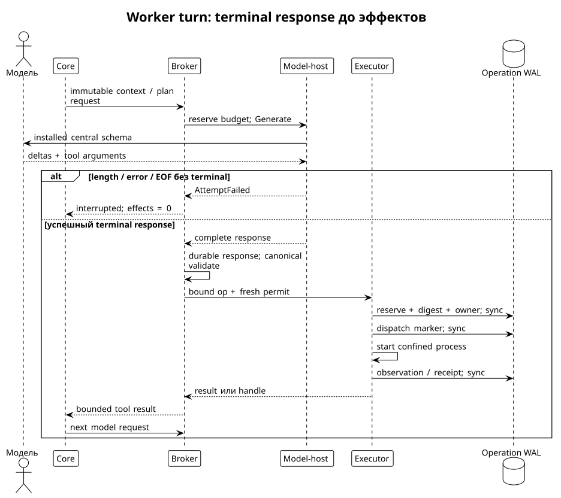

# Модели, credentials, контекст и устойчивый цикл

Статус: proposed architecture. Факты о продуктах ниже относятся к принятым снимкам 2026-09-08, а не к проверке конкретного аккаунта. [Provider research](../../.research/260908_provider-portability.md), [evidence registry](../../.research/260908_provider-portability-evidence.md), [исследовательские аномалии](../../.research/260908_provider-portability-logbook.md).

## ModelPort и AgentBridge

Default — прямой inference через разрешённый API или действительно локальную модель. `ModelPort` принимает conversation projection, immutable tool definitions, budgets и несекретный BindingRef; возвращает typed model events. Он не выполняет tools. Provider SDK types остаются внутри codec. Model-host прикрепляет credentials к разрешённой audience через локальный secret service; broker не передаёт ключ core.

`AgentBridge` запускает поддерживаемый **целый агент**, принимает task/constraints и возвращает upstream session events/artifacts. Он владеет собственными loop, compaction, tool routing и auth. Это не реализация `ModelPort.Generate` и не тот же Go loop. Bridge не может выдавать свои внутренние events за полное наблюдение inference/effects. В strict worker он по умолчанию не допускается; compatibility profile имеет отдельный assurance record, pinned binary/config и независимую ОС-изоляцию. Если публичные supported settings не позволяют исключить лишние effects, strict-equivalence probe провален, а не исправляется имитацией другого клиента.

В Codex dynamic tools добавляются к составному router, а не заменяют все core/hosted tools: [pinned router](https://github.com/openai/codex/blob/8e694e955ae02ca737230a5468c55d5847074072/codex-rs/core/src/tools/spec_plan.rs#L974). В Claude SDK `tools` и `allowed_tools` имеют разные значения; allowlist auto-approval не доказывает отсутствие остальных surfaces: [pinned options](https://github.com/anthropics/claude-agent-sdk-python/blob/efd4d865ef1795daffee3cd24cce45307aed8a51/src/claude_agent_sdk/types.py#L1941). Bridge binary/settings/plugins/hooks, служебный FS и hosted tools входят в qualification. Никакого patch чужого binary ради обхода auth или извлечения OAuth.

Proposed ports:

```go
type AgentBridge interface {
    Start(context.Context, DelegatedTask, BridgePolicy) (UpstreamRun, error)
    Observe(context.Context, UpstreamRun, Cursor) (AgentEventPage, error)
    Cancel(context.Context, UpstreamRun) (CancelObservation, error)
}
type Capabilities struct {
    CodecRevision string
    ToolSchemaDialect string
    ExplicitTerminal bool
    OpaqueReasoning bool
    ResumeMode string // none, request-replay, provider-session
    Cancellation string // disconnect-only, server-request
    InputLimit, OutputLimit, ToolSchemaLimit int64
}
```

Unknown capability не трактуется как поддержанная. Capabilities — технические свойства pin/model route; entitlement — право данного use case/account; billing — lane и предел расходов; assurance — наблюдаемая изоляция deployment. Четыре записи имеют разные issuers, сроки и evidence. HTTP 200 не доказывает ни договорное разрешение, ни confinement.

## Матрица маршрутов, не обещание всех подписок

| Route | Выбранная политика Apiary | Основание и предел |
|---|---|---|
| OpenAI Responses API | Базовый direct adapter; отдельный API account/billing | [Auth](https://learn.chatgpt.com/docs/auth); ChatGPT login не API key |
| Codex app-server + ChatGPT login | Optional official whole-agent bridge; strict worker пока не qualified | [App-server](https://learn.chatgpt.com/docs/app-server); raw subscription backend для собственного loop не установлен |
| Anthropic Messages API | Direct codec, workspace-bound key/WIF | [API auth](https://platform.claude.com/docs/en/manage-claude/authentication) |
| Claude Code / Agent SDK + subscription | Optional неизменённый user-owned agent, по условиям размещения | [Legal](https://code.claude.com/docs/en/legal-and-compliance), [plan notice](https://support.claude.com/en/articles/15036540-use-the-claude-agent-sdk-with-your-claude-plan); приостановленную credit table не использовать как тариф |
| Gemini Developer API / Vertex | Direct adapters с project/region/IAM | [API keys](https://ai.google.dev/gemini-api/docs/api-key), [Cloud auth](https://docs.cloud.google.com/gemini-enterprise-agent-platform/models/start/gcp-auth) |
| Gemini CLI OAuth backend | Не использовать как сторонний direct inference | [CLI terms](https://geminicli.com/docs/resources/tos-privacy/); наличие OSS adapter не отменяет ограничение |
| Bedrock / Azure | Отдельные cloud identity и deployment routes | [Converse](https://docs.aws.amazon.com/bedrock/latest/userguide/conversation-inference.html), [Azure Responses](https://learn.microsoft.com/en-us/azure/foundry/openai/how-to/responses); не consumer subscriptions |
| DeepSeek / Qwen DashScope PAYG / Kimi Open Platform | Direct compatibility codecs после negotiation | [DeepSeek tools](https://api-docs.deepseek.com/guides/tool_calls/), [DashScope API](https://www.alibabacloud.com/help/en/model-studio/compatibility-of-openai-with-dashscope), [Kimi API](https://www.kimi.com/en/help/kimi-api/api-overview) |
| Alibaba Coding Plan | Не baseline headless swarm | [FAQ](https://www.alibabacloud.com/help/en/model-studio/coding-plan-faq): ограничения scripts/backends |
| Alibaba Token Plan | Conditional: редакции условий расходятся; default PAYG | [Plan](https://www.alibabacloud.com/help/en/model-studio/token-plan-overview), [официальный blog](https://modelstudio.alibabacloud.com/intl/blog/model-studio-token-plan-individual/) |
| Kimi Code membership API key | Допустимый candidate для coding client при его условиях; pooling не установлен | [Membership](https://www.kimi.com/en/help/kimi-code/membership-guide); не CLI OAuth |
| OpenRouter | Явно admitted gateway и upstream allowlist, no hidden fallback | [Routing](https://openrouter.ai/docs/guides/routing/provider-selection), [BYOK](https://openrouter.ai/docs/guides/overview/auth/byok); BYOK передаёт key gateway |
| Ollama / собственный endpoint | Local только при подтверждённом local execution и допустимых weights | [Auth](https://docs.ollama.com/api/authentication); localhost может проксировать cloud |

В этой работе аккаунты и тарифы не проверялись. Перед включением route operator сохраняет dated entitlement decision с use case, owner/tenant, endpoint, product, data classes, expiry и ссылкой на действующие условия. Отсутствующий маршрут просто недоступен. Это не блокирует выбранный direct baseline. Подписки не объединяются в пул credentials, квоты не обходятся сменой аккаунта.

## Credential и budget lifecycle

`CredentialBinding = {owner, product, tenant, endpoint_set, auth_kind, secret_ref, generation, expiry}`. `secret_ref` opaque и имеет смысл только на host владельца. Secret не появляется в argv, tool env, transcript, XMPP или diagnostic error. Redirect на другую audience не наследует Authorization. Local model endpoint не получает cloud key для «совместимости».

Закрытые состояния: `unconfigured`, `authenticating`, `active`, `refreshing`, `expired`, `revoked`, `reauth_required`, `disabled`. Refresh — один coordinated writer на binding с CAS generation и atomic replacement. `invalid_grant` ведёт к reauth, не storm retries. Refresh той же admitted identity не меняет sink; смена account/tenant/provider/endpoint/data retention — новый route admission и при изменении plan новая epoch. Logout закрывает новые dispatch и очищает доступность credential; outstanding attempts сохраняют accounting.

Личный ключ contributor и transport credentials находятся в отдельных доменах. Runner обращается к отдельному сервису подписи candidate commit; эта подпись не даёт права публикации. Raw write authority к локальному main/protected ref принадлежит исключительно `publication-gateway`. Credentials внешнего mirror ограничены отдельной операцией и sink policy; они не дают runner права менять локальный authoritative main. См. [границы процессов](kernel.md) и [контракт публикации](execution.md#l0-publication-gateway-и-recovery-f2).

До model dispatch broker атомарно резервирует request/token/spend лимиты одновременно по owner/project/task/session/route. Числовой бюджет задаётся владельцем, не моделью; ядро знает только allocation/result. В разных валютах и subscription credits нет скрытого conversion. Неизвестная цена требует отдельного bounded token/request allowance либо отказа. Usage cumulative deltas учитываются как обновление, не суммируются дважды. Missing usage = unknown, резерв не освобождается как zero spend. Tool CPU/disk/network budgets ведёт executor независимо от inference.

SDK retries отключены в baseline; model-host — единственный владелец retry: максимум 3 попытки с jittered backoff, только transient transport/429/5xx и только в существующем reserve/deadline. Auth errors выделены в `auth_expired`, `entitlement_denied`, `reauth_required`; quota в `quota_exhausted`, policy в `route_denied`, wire в `protocol_error`, cancellation в `cancel_requested`. Предыдущий incomplete model attempt не используется как successful response. Повтор inference не повторяет уже admitted tool operation. Server cancel — best effort; не обещаем немедленное прекращение billable work. Локальный бюджет не ограничивает сторонние клиенты того же аккаунта: для абсолютного account cap нужен provider-side лимит.

## Stream и turn state

Session lifecycle: `opening → idle → generating → validating → dispatching → observing → idle`; отдельно `compacting`, `draining`, `paused`, `closed`, `faulted`. Нормальный ответ без tool calls завершает turn, но не принимает проектную задачу. Один active turn на session. Steering имеет message ID и expected turn; durable inbox подтверждает append. Новое сообщение для старого turn не silently запускает другой. Cancel фиксирует cutoff принятой очереди, более поздние inputs остаются отдельными.

Canonical events: `InputAccepted`, `AttemptStarted`, `TextDelta`, `OpaquePart`, `ToolCallAssembled`, `AttemptSucceeded`, `AttemptFailed`, `CallAdmitted`, `CallObserved`, `CompactionCommitted`, `EpochChanged`, `TurnStopped`. Token deltas могут быть transient UI; durable authority не зависит от того, успел ли записаться каждый token. До tool dispatch broker должен иметь durable полный assistant response с успешным terminal, точные args и provenance. `length`, error, EOF без terminal, duplicate call ID и неизвестный provider block — refusal, даже если partial JSON синтаксически валиден. Baseline ждёт весь terminal response; это сознательно увеличивает latency старта tools, но уменьшает crash state space. [Codex/Pi stream analysis](../../.research/260908_codex-pi.md).

Native function calling не является отдельной встроенной capability: codec проецирует installed Curator exports. Hosted search/code/interpreter/browser tools выключены. Неожиданное provider-side tool event останавливает route с evidence; отсутствие локального callback не доказывает отсутствие hosted effect. Tool calls исполняются последовательно; concurrency разрешается только проверенным `parallel-safe` binding для disjoint resources с shared quota. Для shell весь sandbox workspace-exclusive, включая long-running process до его завершения.



## Контекст, compaction и persistence

История, prompt projection, provider cache и executor state — четыре разных состояния. Canonical history хранит exact representation digest и provenance каждого отправленного model input; runtime/skill/repository instructions берутся из verified immutable store. Tool output, remote messages и найденный текст — data. Compaction не повышает их до policy. [Pi history/projection](../../.research/260908_codex-pi.md), [Hermes/Kimi interfaces](../../.research/260908_go-and-additional-harnesses.md).

В baseline context planner резервирует output budget и место под bounded next tool result, затем оценивает prompt токены с tokenizer/count endpoint конкретной модели. При достижении 80% доступного input budget запускается compaction; 80% — стартовая policy, проверяемая экспериментом. Сохраняются task goal/contract refs, active constraints, current plan, pending operations, последние causal call/result пары и ссылки на artifacts. Модельный summary помечается derived data, имеет source span/digest и не заменяет canonical log.

Compaction двухфазна: записать draft projection и source head → проверить bounds/causal completeness → CAS active projection на тот же history head. Если история продвинулась, draft пересобрать; crash до CAS оставляет прежний prompt. Summary без точного source span не принимается. Opaque reasoning/signatures сохраняются byte-exact с owner/provider/model/adapter scope и порядком parts. При несовместимом переносе provider они исключаются с explicit lossy transition; переносится публичная task summary, а не поддельное reasoning continuation.

Provider previous-response/session IDs — оптимизация, не authority. Cache key включает owner/tenant/product/endpoint/model revision/adapter, system bundle, tools schema, retention и exact prefix. Mismatch → полный допустимый replay или typed refusal; никогда cross-account continuation. Смена cache не повторяет effects. Provider session lost не означает sandbox lost и наоборот.

Broker session WAL использует одного fenced writer, checksummed records и transactional commit; durable input ack только после sync. Executor operation WAL и authority ledger отдельны, с causation links. Corrupt committed middle record → quarantine/faulted; torn uncommitted tail можно отбросить с явной recovery записью. Нельзя skip malformed row и объявлять отсутствие вызова. Resume: проверить plan/input store → получить fresh writer/authority fence → загрузить committed history → reconcile pending operation refs → построить projection → допустить новый turn.

Local retention default `private`: encrypted-local transcript/content, restricted operator access; metadata/receipt digest остаётся по project policy. `replayable` хранит нужные plaintext-equivalent payloads шифрованно для воспроизведения; `ephemeral` удаляет payload после session и делает full model replay недоступным, сохраняя bounded metadata. Exact bytes, которые видел remote worker вне honest runtime, сеть доказать не может. Provider retention — отдельные условия sink. Секреты redacted до любых persisted diagnostics; hash секретного низкоэнтропийного значения не делает его безопасным для публикации.
