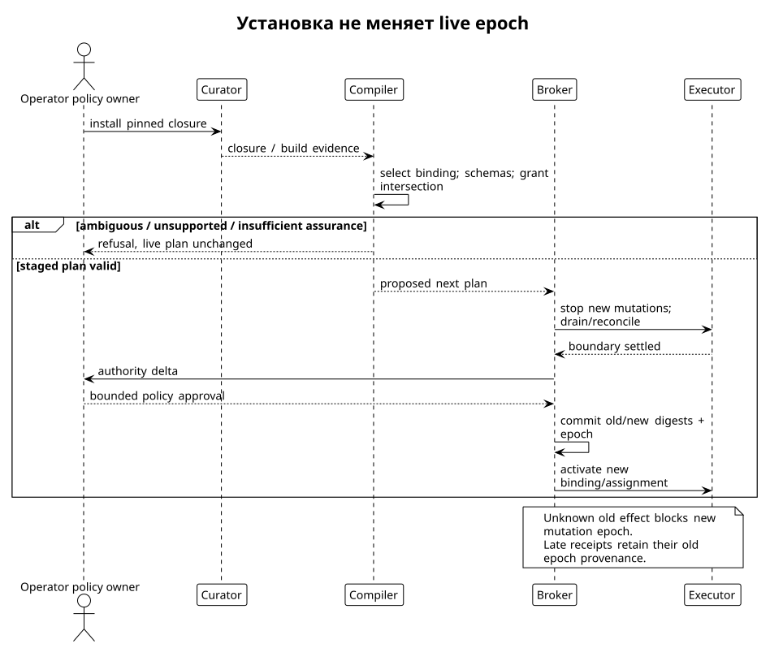

# Curator tool-skills и remote workspace

Статус: proposed contracts, `apiary-design-2026-09-08`. [Ядро](kernel.md), [исполнение](execution.md).

## Что уже существует и что предлагается

Curator определяет content-addressed package/closure, source build и install/profile composition. Это не готовый agent runtime. Принятая проверка обнаружила refusal для `script-worker-v1` и отсутствие production verified-provider resolver; объявление capability не доказывает работающий daemon. [Curator source](https://github.com/relux-works/curator/blob/2d0901444ecfe3c11c424c561c66c66b4bb5ddd1/internal/scriptpolicy/scriptpolicy.go#L85), [assurance resolver](https://github.com/relux-works/curator/blob/2d0901444ecfe3c11c424c561c66c66b4bb5ddd1/cmd/curator/assurance.go#L17), [принятые контракты](../../.research/260908_apiary-curator-contracts.md).

Package digest удостоверяет bytes package. Build-artifact digest — bytes executable с toolchain/environment provenance. Авторская подпись связывает заявление с ключом. Audit status — утверждение registry по его policy. Grant — разрешение. Host enforcement report — фактическая степень изоляции. Ни одно из них не заменяет остальные. Compiler проверяет все необходимые для выбранного профиля классы, а не слово `verified` в manifest.

Предлагаемый descriptor добавляет executable tool contract поверх curator-spec package. Ниже сокращённый JSON object, не действующий Curator manifest; `sha256:` с 64 hex — формат, значения иллюстративные:

```json
{
  "descriptor_version": "apiary-tool-proposal-1",
  "package": {"name": "apiary-central-client", "version": "1.0.0", "content_digest": "sha256:aaaaaaaaaaaaaaaaaaaaaaaaaaaaaaaaaaaaaaaaaaaaaaaaaaaaaaaaaaaaaaaa"},
  "exports": [{
    "export_id": "central",
    "interface_id": "curator.tool/apiary-central@1",
    "entrypoint": "bin/central-client",
    "execution_class": "process",
    "lifecycle": "one-shot",
    "input_schema": "contracts/central-input.json",
    "output_schema": "contracts/central-output.json",
    "effect_contract": "contracts/central-effects.json",
    "vectors": "contracts/central-vectors.json",
    "concurrency": "workspace-exclusive",
    "operations": ["exec", "poll", "cancel"]
  }],
  "requested_capabilities": {"remote_executor": ["project-assigned"], "credentials": [], "signing": []}
}
```

Closure lock pin включает transitive source dependencies; build record связывает source closure, driver, toolchain, target OS/arch и artifact digest. Для Go используется действующий closed build driver Curator с explicit first-party modules/vendor graph; не обходим `internal` копированием пакетов. [curator-spec core, Go driver](https://github.com/relux-works/curator-spec/blob/87a0d0060bad64ab883d007dcdf35df7485368bf/protocol/core.md#L965).

## Compiler и выбор binding

1. Resolver Curator выдаёт pinned closure artifact. Compiler проверяет bytes и supported contract versions; errors чтения не равны отсутствию необязательного поля.
2. Проверяются install/audit policy, executable provenance, platform class и interface vectors. Audit gate не исполняет недоверенный provider с полномочиями compiler.
3. Operator profile явно выбирает `interface → package digest + export`. Co-installed alternatives разрешены. Ноль selected implementations — `binding_missing`; более одной — `binding_ambiguous`. Дубликат `tool_id` всегда ошибка. Это изменение v0.1 §6, где конфликтом считалось само наличие двух implementations.
4. Canonical input/output schemas, lexical extractor и semantic limits фиксируются digest. Provider model-facing schema — отдельная projection с собственным digest и version. Compiler запрещает unsupported projection до открытия epoch.
5. Grant вычисляется пересечением package envelope, operator policy, task contract, assignment и platform assurance; unknown metadata не расширяет пересечение. Workspace и sinks привязываются по identity.
6. Emit SessionPlan с executable/delegable authority, выбранными exports, context bundle, model route, local retention, limits и assurance. Broker независимо проверяет digest/подпись, closure, policy и peer identity перед `Open`.

Пример выбранного binding, также proposed fragment:

```json
{
  "tool_id": "central",
  "interface_id": "curator.tool/apiary-central@1",
  "selected_package": "sha256:aaaaaaaaaaaaaaaaaaaaaaaaaaaaaaaaaaaaaaaaaaaaaaaaaaaaaaaaaaaaaaaa",
  "export_id": "central",
  "grant": {"sandbox_id": "sb-17", "generation": 3, "ops": ["exec", "poll", "cancel"], "network": "none", "max_operations": 200, "max_processes": 1},
  "model_projection": {"codec": "responses-functions-v1", "tool_name": "central"}
}
```

Числа — предлагаемые стартовые ограничения для conformance, не измеренные оптимальные настройки. Production plan всегда содержит конкретные значения, а не наследует скрытый process-global default.

## Один tool и реальная полезность

Выбран минимум `central.exec` с `argv` и optional explicit `sh -c` внутри sandbox; `poll` и `cancel` обслуживают только выданные process handles. Нет `method`, `url`, arbitrary service name, signing payload или списка будущих административных операций. Shell может делать многое внутри sandbox — это явный широкий **task-local** grant, а не «узость одного имени». Основания минимальности: [mini-SWE DefaultAgent](https://github.com/SWE-agent/mini-swe-agent/blob/04d809ceab9df28f9adaed044884180159172930/src/minisweagent/agents/default.py#L88), [CodeAct](https://arxiv.org/html/2402.01030v4), [v0.1 shell instrumentation](../architecture.md). Рекомендацию исследования Codex/Pi не включать arbitrary command принимаем в части отсутствия универсального RPC; запрет самого shell отклоняем: выдаём честный ограниченный command interface, измеряем typed replacement opportunity, не создаём заранее огромный каталог операций.

Proposed model input `exec`:

```json
{
  "op": "exec",
  "exec": {"argv": ["go", "test", "./internal/parser"], "cwd": "repo", "env": {"GOMAXPROCS": "2"}, "timeout_ms": 120000},
  "poll": null,
  "cancel": null
}
```

Portable projection для provider, не поддерживающего `oneOf`, использует object с полями `op,exec,poll,cancel`, inactive поля `null`. Authoritative schema допускает ровно одну согласованную branch; `null` нужен в новой schema version, его нет в portable subset v0.1. Если codec не может представить nullable fields, используется отдельная закреплённая flat projection с явной omission semantics и loss report. Нельзя молча удалить constraints: compiler допускает projection только если каждое допустимое canonical значение представимо, а broker снова применяет canonical validator. Если model API требует несовместимую форму/превышает tool-name/description/schema limits — `schema_unsupported`, новая модель или новый явно скомпилированный plan, не скрытая подмена tool.

Правила input: UTF-8 без NUL; unknown fields запрещены; `op` enum; argv 1–128 strings, суммарно ≤32 KiB; cwd ≤1024 bytes, относительный lexical path без `..` и абсолютного prefix; env ≤32 разрешённых имён/8 KiB, без inherited secrets; timeout 1–120000 ms для обычного worker exec. Для длительного процесса grant может явно разрешить до 30 min; client response ждать не дольше 2 s, затем handle/poll. Name `central` стабилен, provider-native call IDs сохраняются как aliases к canonical call. Невалидный output skill — protocol failure, не инструкция модели.

Lexical extractor для `exec` выдаёт `precision: unknown` и весь task-local execution ceiling; argv-анализ не доказывает подкоманды/реальные paths. Для `poll` — bounded read собственного output store; для `cancel` — bounded control конкретного process group. Trusted executor применяет реальные mount/network/process restrictions. Подмена symlink между lexical check и open проверяется backend через handle-relative resolution/no-follow и sandbox mount boundary; deterministic extractor не обращается к FS и не утверждает разрешение inode. [v0.1 extractor](../../protocol/tool-interface.md), [requirements D05–06](../../.research/260908_requirements-map.md).

## WorkspaceRef без локального checkout

`Session.Open` следующей ревизии принимает `WorkspaceRef`, а не обязательный абсолютный путь. Discriminated union:

```json
{
  "kind": "remote",
  "project_id": "prj-apiary",
  "executor_id": "exec-a",
  "sandbox_id": "sb-17",
  "sandbox_generation": 3,
  "base_commit": {"object_format": "sha1", "oid": "1111111111111111111111111111111111111111"},
  "base_content_digest": "sha256:aaaaaaaaaaaaaaaaaaaaaaaaaaaaaaaaaaaaaaaaaaaaaaaaaaaaaaaaaaaaaaaa",
  "mount_alias": "repo"
}
```

`local` variant содержит canonical absolute `workspace_root` и `worktree_id`; её обрабатывает local broker/backend. `remote` запрещает local path; executor registry отображает `(project,sandbox,generation,mount_alias)` в физический root. Модель и contributor не выбирают host path. `cwd: repo/internal` разрешается внутри этого mount; `/etc`, escape и чужой alias отказываются. Base locator явно qualified по Git object_format; base_content_digest — обязательный C(M) из [content manifest contract](execution.md#сильная-идентичность-candidate-bytes-f1), проверяемый executor при materialization. SHA-256 envelope с SHA-1 locator не заменяет это поле. State/cache directory broker — отдельный runtime storage, не фиктивный checkout. Remote context bundle доставляется digest-addressed из committed task/base и installed skills; файлы repository instructions из mutable sandbox никогда автоматически не повышаются до instruction tier.

Proposed `OpenRequest` связывает `workspace_ref`, `assignment_ref`, `plan_digest`, `epoch_id` и authenticated principal. `Open` не создаёт authority из этих полей: broker проверяет committed assignment и executor ownership. Schema v1 remote input отвергает; version negotiation не пытается построить fake `/tmp/repo`. Restart sandbox увеличивает generation, все старые handles становятся `session_lost`; новый grant/assignment binding нужен до нового exec.

## Host extensions, lifecycle и epochs

Model-facing tools поставляются user-space skills. Provider/auth adapters, XMPP, logging sinks, sandbox drivers и signer policy — operator-installed host extensions с отдельными privileges, не экспортируемыми в model catalog. Проектный Skillfile не выбирает credential adapter или trusted daemon. Native function calling — codec projection **установленных** exports; core не поставляет model tools. MCP допустим только во внешнем confined wrapper, фиксирующем catalog/schema digest; `tools/list_changed`, resources и prompts не изменяют plan и provenance tier.

Skill process protocol proposal: length-prefixed UTF-8 JSON (uint32 big-endian, ≤1 MiB/frame), stdout только frames, stderr bounded diagnostic stream; descriptor связывает protocol revision. Broker создаёт one-shot process с private capability IPC FD и чистым env, передаёт один validated invocation, читает один terminal response и завершает process group. Process exit без response — `provider_protocol_error`; timeout — cancellation/unknown по execution receipt, не fake success. Wrapper не получает remote grant signing key: broker уже создал bound operation.

Lifecycle vocabulary: `installed → verified → staged → active → draining → stopped`; `rejected` из verify/stage; `quarantined` из active при protocol/integrity failure. One-shot default. Session-worker оптимизация разрешается только для одной binding и неизменного ceiling, с health framing, bounded concurrent calls и no ambient secrets. Death worker process не означает death remote command: операция живёт у executor и reconciles по operation ID. Automatic restart client возможен без повторного exec.

Epoch transition: stop new mutations → drain/cancel/reconcile outstanding operations и process handles → compile новую closure → показать authority delta trusted policy owner → commit approval/policy grant и new plan → activate. Если unknown effect не разрешён, новая mutation epoch не открывается; допустим read-only recovery channel старого owner. Установка новой версии на диск не меняет работающие bindings. Rollback package версии — тоже новая epoch и audit freshness check, не замена executable под старым digest.



Закрытые admission errors: `invalid_input`, `schema_unsupported`, `binding_missing`, `binding_ambiguous`, `integrity_mismatch`, `audit_denied`, `policy_denied`, `assurance_insufficient`, `stale_epoch`, `stale_contract`, `stale_term`, `stale_generation`, `lease_expired`, `authority_unavailable`, `budget_exhausted`, `conflicting_duplicate`, `provider_protocol_error`, `overloaded`, `session_lost`, `internal_error`. Неизвестная error identity — protocol failure. `internal_error` не даёт retry permission; состояние эффекта передаётся отдельно из operation ledger.
